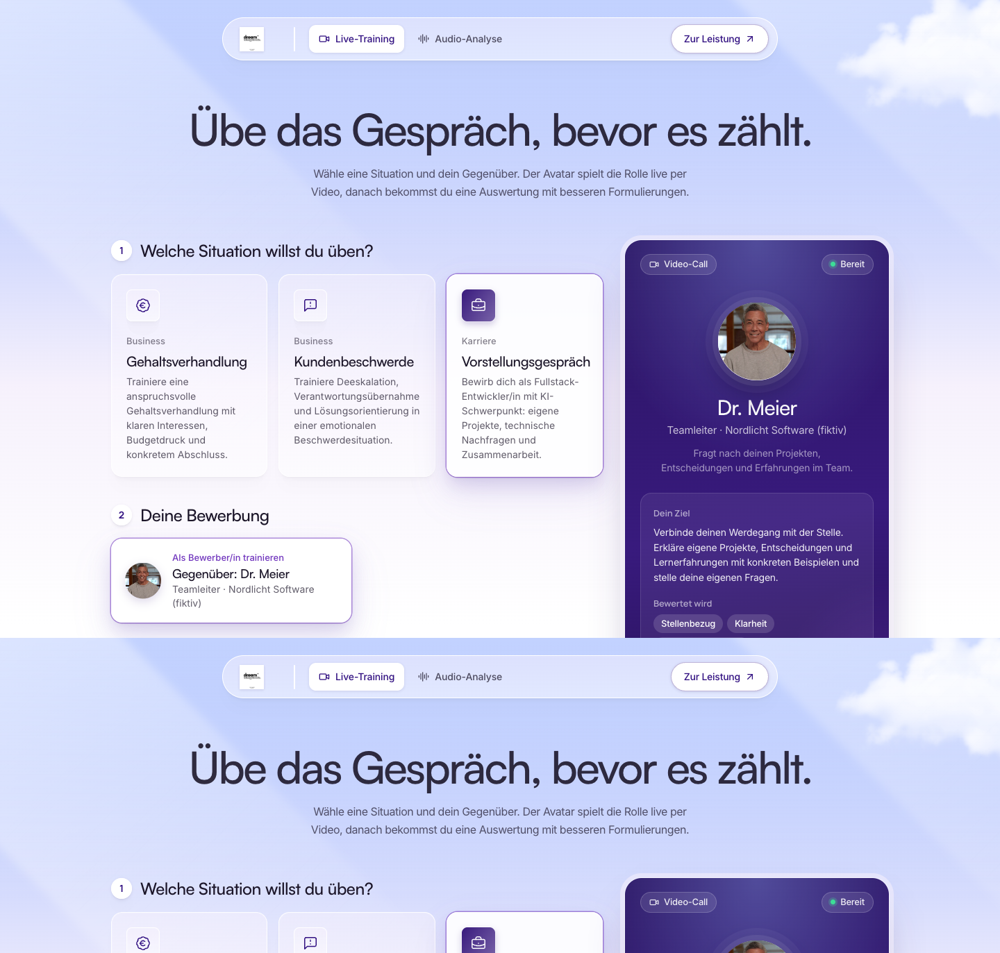
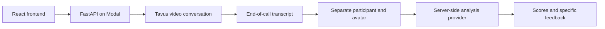

# CoachVoice — AI communication training

Practice a difficult conversation with a live video avatar, then review feedback based on the actual transcript.

**[Open the live demo](https://coach.dreamtelligence.de/)** · [Dreamtelligence](https://www.dreamtelligence.de/)



## What this project demonstrates

- React 18, TypeScript and Vite frontend with responsive scenario and role selection.
- Python/FastAPI backend deployed on Modal; provider credentials stay on the server.
- Tavus video roleplay with separate personas, German conversation settings and visible AI disclosure.
- Transcript parsing that separates the participant's statements from the avatar's context.
- Structured feedback on empathy, clarity and outcomes, including alternative phrasings and handling of speech-recognition errors.
- Audio-upload analysis using NVIDIA Parakeet on a serverless GPU.
- Session-bound HMAC tokens, upload validation and rate limiting; tests exercise these boundaries.

Three public B2B scenarios provide five practice sides: salary negotiation (employee/manager), customer complaint (support/customer), and a **Fullstack/AI job interview** (applicant). Interviews use their own interaction rules and scoring rubric.

The interview includes a visible fictional job brief, project and technical follow-up questions, an AI/data-safety case, collaboration and time for the applicant's questions. Feedback covers job relevance, clarity and technical substance. Each score must cite an actual participant statement; unsupported areas display **not assessable**, rather than zero points. These are training scores, not validated hiring assessments or predictions. [Research, design and verification limits](docs/interview-design.md).

## Main flow



The upload flow sends audio to the backend, transcribes it with Parakeet and passes the transcript to the same analysis layer. Live calls and GPU uploads consume provider resources; the demo is rate limited.

## Run the frontend

Node.js 24 is the CI runtime. From the repository root:

```bash
cd frontend
npm ci
npm run dev
```

Vite proxies `/api` to the deployed Modal backend. To use another backend:

```bash
VITE_API_PROXY_TARGET=https://your-backend.example npm run dev
```

`frontend/vercel.json` defines the production API rewrite. A local frontend does not need provider keys. Starting a conversation or uploading audio still uses the configured backend.

## Run checks without provider credentials

```bash
python3.12 -m venv .venv
.venv/bin/python -m pip install -r requirements-test.txt
.venv/bin/python -m unittest discover -s tests -v

cd frontend
npm ci
npm run build
```

The Python suite tests prompt construction, scenario roles, transcript parsing, analysis output, session tokens, rate limiting and Tavus request payloads. Provider calls in these unit tests are mocked; they do not start a paid session or prove live provider availability. GitHub Actions runs the suite and the frontend build on pushes and pull requests.

An optional paid Gemini regression check uses five fictional interview transcripts, including unsafe technical answers and conversations with insufficient evidence:

```bash
# Supply GEMINI_API_KEY securely in the environment.
PYTHONPATH=. .venv/bin/python scripts/evaluate_interview.py
```

See the dated [verification and recruiter review](docs/recruiter-review.md) for actual results and remaining checks. GitHub Actions was blocked by an account billing issue during that review; local checks and remote CI status are reported separately.

## Deploy the backend

The GPU image and remote dependencies are defined in `transcribe_demo.py`. Local deployment tooling is separate from the test requirements:

```bash
.venv/bin/python -m pip install modal python-multipart
cd frontend && npm ci && npm run build
cd ..
.venv/bin/modal deploy transcribe_demo.py
```

Configure credentials as Modal secrets, never in source control:

| Secret | Variables | Used for |
| --- | --- | --- |
| `Tavus` | `TAVUS_API_KEY` | Avatar setup and calls |
| `my-gemini-secret` | `GEMINI_API_KEY` | Transcript analysis |
| `my-deepseek-secret` | `DEEPSEEK_API_KEY` | Alternative analysis provider |

`SESSION_SECRET` can override the server-side session-signing secret. `ADMIN_TOKEN` protects manual persona setup when configured. See `coach_app/security.py` for limits and `coach_app/analysis.py` and `coach_app/tavus_client.py` for the current provider settings; account quotas and model availability depend on the provider.

## Code map

| Area | Entry point |
| --- | --- |
| Frontend and live session lifecycle | `frontend/src/CoachAvatar.tsx` |
| Scenario and role definitions | `coach_app/scenarios.py` |
| Tavus integration | `coach_app/tavus_client.py` |
| Transcript handling and analysis | `coach_app/transcript.py`, `coach_app/analysis.py` |
| Request and session boundaries | `coach_app/security.py` |
| HTTP routes and Modal deployment | `transcribe_demo.py` |
| Automated checks | `tests/`, `.github/workflows/ci.yml` |

## Scope and limitations

This is a working portfolio demo, not a multi-user coaching service with accounts, billing or persistent private training histories. Session tokens bind transcript/status operations to the conversation, but are not a user-account system. The in-memory rate limiter relies on the single web-container deployment; per-IP limits on direct backend URLs are best effort. Real microphone/camera behavior, GPU inference, transcript delivery and provider quotas require a separate end-to-end test.

The repository currently has no project-wide open-source license. Provider services, avatar images and model weights retain their respective terms.
