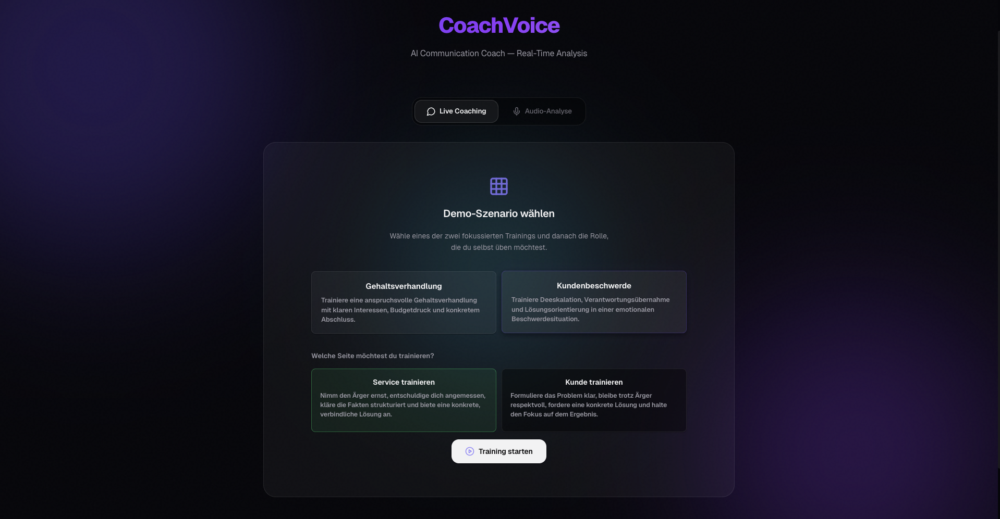
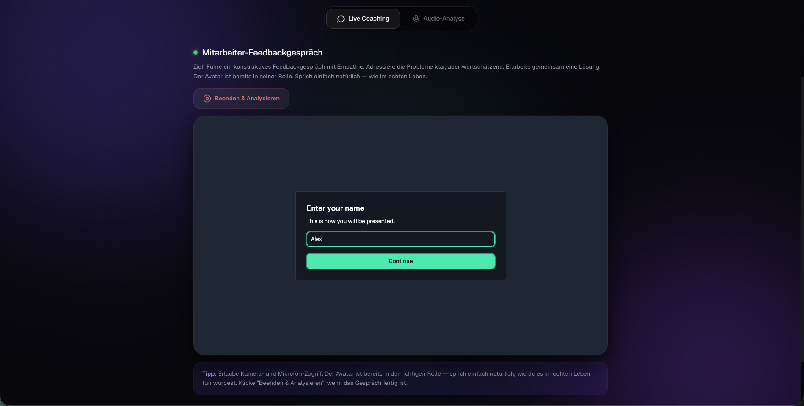
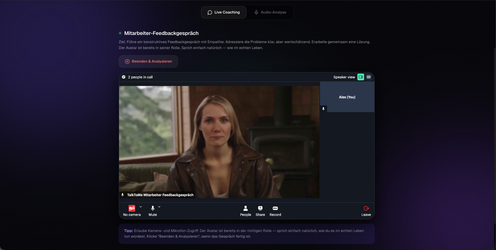
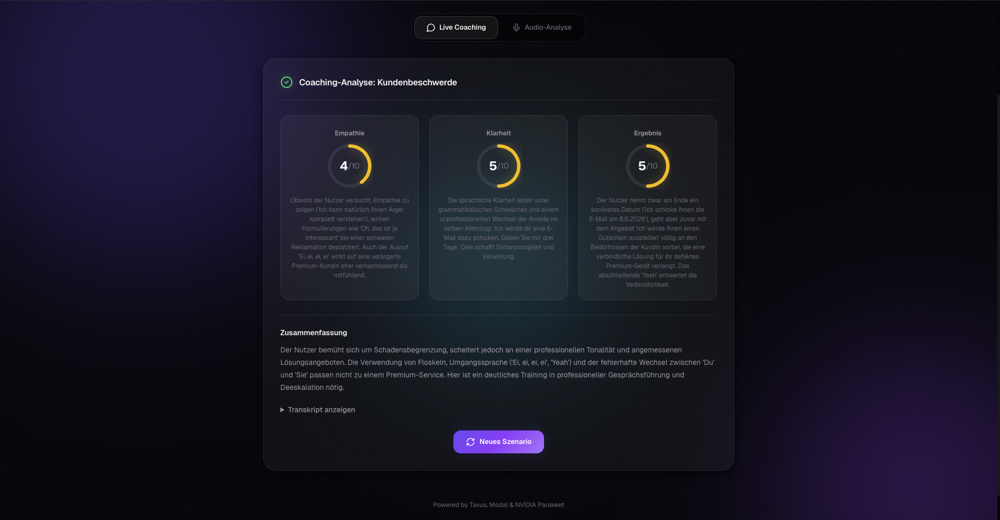

# CoachVoice — AI Communication Coach

**[👉 Live Demo on Modal](https://aliundmaggy--asr-coaching-analysis-fastapi-app.modal.run/)**


CoachVoice is a focused communication-training studio for difficult business conversations. Users practice live roleplays with a Tavus video avatar and receive structured AI feedback based on the actual end-of-call transcript.

The product is intentionally narrow: two strong demo scenarios, each with two trainable sides. This keeps the experience understandable in seconds while still showing real-time AI interaction, role control, transcript retrieval, and analysis quality.

---

## What is CoachVoice?

Most demo coaching apps either generate generic advice or run a shallow chatbot. CoachVoice is built around a stricter loop:

1. The user selects a realistic scenario.
2. The user chooses which side they want to train.
3. Tavus receives a role-specific persona and per-session conversational context.
4. The avatar stays in character during the conversation.
5. The backend ends the Tavus conversation, fetches the verbose transcript, and analyzes only the human user's statements.

The result is a portfolio-grade AI demo that proves more than UI polish: it shows provider orchestration, prompt discipline, transcript handling, secure backend boundaries, and deployable production infrastructure.

---

## Core Features

### 🎭 Role-Aware Tavus Avatar
Each practice side creates a versioned Tavus persona with a strict system prompt. The avatar is explicitly told who it is, who the user is, what the training goal is, and that it must not break role or give coaching feedback during the live roleplay.

### 🧭 Two Focused Demo Scenarios
- **Gehaltsverhandlung** — practice either as the employee asking for a raise or as the manager responding fairly under budget constraints.
- **Kundenbeschwerde** — practice either as customer support de-escalating an angry customer or as the customer presenting a complaint clearly.

### 🔁 Train Both Sides
Every scenario supports two perspectives. This turns the app from a static chatbot into a reusable training tool for negotiation, leadership, customer service, and conflict handling.

### 🧠 Transcript-Based Coaching Analysis
The analysis pipeline evaluates the human user across three dimensions:
- **Empathy & emotional intelligence**
- **Clarity & structure**
- **Result orientation**

Each score is backed by concrete user quotes when a transcript is available.

### 🛡️ Backend-Only Provider Control
Tavus, DeepSeek, Gemini, and NVIDIA ASR keys are never exposed to the browser. Session creation, transcript retrieval, analysis, rate limiting, upload validation, and security headers are handled server-side.

### 🧪 Portfolio-Ready Failure Handling
Provider problems are reported clearly instead of hidden behind generic errors. For example, if DeepSeek has no balance, the UI receives a precise message and the backend attempts Gemini fallback.

---

## Demo Flow

```
Scenario Selection
    ↓
Practice Side Selection
    ↓
Tavus Persona + Conversation Context
    ↓
Live Video Roleplay
    ↓
End Conversation
    ↓
Fetch Tavus verbose transcript
    ↓
AI Coaching Analysis
    ↓
Scores + Feedback + Transcript
```

---

## Studio Impressions

<details>
<summary><strong>CoachVoice Screenshots</strong> — role selection, Tavus join flow, live avatar, and coaching analysis</summary>

### Role Selection
Focused demo entry with two scenarios and two trainable sides per scenario.



### Tavus Name Entry
Embedded Tavus room before the user joins the live coaching session.



### Live Avatar Session
Real-time Tavus avatar roleplay inside the CoachVoice interface.



### Coaching Analysis
Post-call scoring with empathy, clarity, result orientation, summary, and transcript access.



</details>

---

## Scenarios

### Gehaltsverhandlung

| Practice Side | User Trains | Avatar Plays |
|---|---|---|
| Mitarbeiter trainieren | Employee negotiating a fair raise | Dr. Meier, budget-conscious department lead |
| Führungskraft trainieren | Manager responding to a salary request | Alex, high-performing employee expecting perspective |

### Kundenbeschwerde

| Practice Side | User Trains | Avatar Plays |
|---|---|---|
| Service trainieren | Support agent calming an angry customer | Frau Keller, disappointed premium customer |
| Kunde trainieren | Customer presenting a complaint clearly | Herr Brandt, process-bound support representative |

---

## Tech Stack

| Layer | Technology |
|---|---|
| Frontend | React 19, TypeScript 5, Vite 8 |
| UI | Lucide Icons, custom CSS, responsive dark interface |
| Backend | FastAPI, Python 3.12 |
| Deployment | Modal serverless functions |
| Avatar | Tavus Conversational Video Interface |
| Analysis | Gemini API fallback, DeepSeek Chat primary/fallback path |
| ASR | NVIDIA Parakeet TDT 0.6b v2 on Modal GPU |
| Security | Backend secrets, upload validation, rate limiting, security headers |

---

## Architecture Notes

### Tavus Conversation Layer
CoachVoice uses Tavus personas plus per-conversation context:

- `system_prompt` defines durable behavior for a role-specific persona.
- `conversational_context` reinforces the selected scenario and practice side.
- `custom_greeting` starts the roleplay with an in-character opening line.
- `properties.language = "german"` forces the conversation language to German instead of relying on prompt instructions alone.
- `layers.stt.stt_engine = "tavus-parakeet"` selects Tavus' European-language STT path for the persona.
- `verbose=true` is used after the call to retrieve `application.transcription_ready`.

### Analysis Layer
The analysis prompt separates avatar statements from user statements and evaluates only the human participant. Avatar lines are kept as context, not as scored content.

### Provider Fallback
DeepSeek is supported through the OpenAI-compatible API client. Gemini is supported via REST `generateContent` and includes model fallback for temporary model overload.

Current production note: the Modal secret `my-deepseek-secret` is configured, but the DeepSeek account currently returns `402 Insufficient Balance`. Gemini fallback is active.

---

## Project Structure

```
AI_Communication_Coach/
├── transcribe_demo.py          # Modal + FastAPI entry point
├── coach_app/
│   ├── analysis.py             # Analysis prompts, Gemini fallback, JSON parsing
│   ├── scenarios.py            # Two demo scenarios + trainable role definitions
│   ├── schemas.py              # Pydantic request/response models
│   ├── security.py             # Rate limiting, security headers, upload checks
│   ├── tavus_client.py         # Tavus persona/conversation API client
│   └── transcript.py           # Tavus transcript extraction + speaker parsing
├── frontend/
│   ├── index.html              # Vite HTML shell
│   ├── public/favicon.svg      # App favicon
│   └── src/
│       ├── App.tsx             # App shell and tabs
│       ├── CoachAvatar.tsx     # Scenario/role selection, iframe, analysis UI
│       └── index.css           # Full responsive UI styling
└── tests/
    └── test_transcript.py      # Transcript and scenario tests
```

---

## Getting Started

### Prerequisites

- Python 3.12+
- Node.js and npm
- Modal account
- Tavus API key
- Gemini API key and/or DeepSeek API key

### Install

```bash
# Backend environment
python3 -m venv .venv
source .venv/bin/activate
pip install modal fastapi[standard] python-multipart openai requests

# Frontend dependencies
cd frontend
npm ci
```

### Modal Secrets

Create these secrets in Modal:

| Modal Secret | Key | Required | Description |
|---|---|---:|---|
| `Tavus` | `TAVUS_API_KEY` | Yes | Tavus API key for personas and conversations |
| `my-gemini-secret` | `GEMINI_API_KEY` | Yes* | Gemini analysis fallback |
| `my-deepseek-secret` | `DEEPSEEK_API_KEY` | Optional* | DeepSeek analysis provider |
| `Tavus` | `TAVUS_DEFAULT_REPLICA_ID` | Optional | Override default Tavus replica |

*At least one analysis provider must be usable. The code also accepts the legacy typo `TAURUS_API_KEY` for Tavus to avoid breaking older Modal secrets, but new secrets should use `TAVUS_API_KEY`.

### Build and Deploy

```bash
cd frontend
npm run build

cd ..
.venv/bin/modal deploy transcribe_demo.py
```

Live app:

```text
https://aliundmaggy--asr-coaching-analysis-fastapi-app.modal.run/
```

Modal dashboard:

```text
https://modal.com/apps/aliundmaggy/main
```

---

## API Endpoints

| Endpoint | Method | Description |
|---|---|---|
| `/api/scenarios` | `GET` | Returns the two demo scenarios and their trainable sides |
| `/api/session/status` | `GET` | Checks Tavus configuration |
| `/api/session/create` | `POST` | Creates a Tavus conversation for selected scenario and side |
| `/api/session/analyze` | `POST` | Ends/fetches Tavus transcript and runs coaching analysis |
| `/api/tavus/setup` | `POST` | Server-only Tavus persona setup, protected by `X-Admin-Token` |
| `/api/transcribe` | `POST` | Audio upload transcription path via NVIDIA Parakeet |

---

## Quality Checks

```bash
# Frontend
cd frontend
npm run typecheck
npm run build
npm audit --audit-level=moderate

# Backend
cd ..
.venv/bin/python -m py_compile transcribe_demo.py coach_app/*.py tests/*.py
.venv/bin/python -m unittest discover -s tests
.venv/bin/python -m pip check
```

---

## Status

This is an active portfolio project. The live Tavus roleplay works, the scenario/role model is intentionally focused, and the analysis pipeline is deployed with provider fallback.

The current production URL is hosted on Modal:

**https://aliundmaggy--asr-coaching-analysis-fastapi-app.modal.run/**
